





<a href="https://github.com/CristopherAguiar/TaxLens"></a>
<a href="https://github.com/tachovendo-ai"></a>


<a href="https://www.linkedin.com/in/cristopher-aguiar/">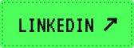</a>
<a href="https://www.instagram.com/cristopher.aguiar/">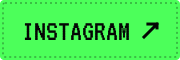</a>
<a href="https://www.behance.net/cristopaguiar">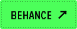</a>
<a href="mailto:commacriativo@gmail.com">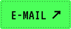</a>


<picture>
  <source media="(prefers-color-scheme: dark)" srcset="https://raw.githubusercontent.com/CristopherAguiar/CristopherAguiar/output/pacman-contribution-graph-dark.svg">
  
</picture>

